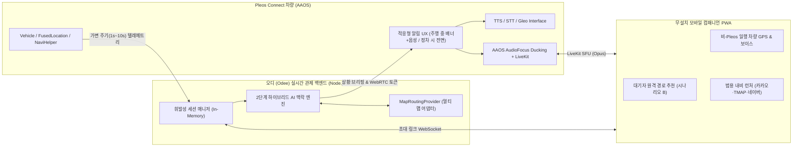

# 오디 (Odee): 차량 데이터 기반 AI 그룹 주행 관제 및 심리스 보이스 링크 서비스 기획서 (v3.0)

> **현대자동차·기아 Pleos Playground 차량용 앱 개발 공모전 출품 마스터 기획서**  
> **공모 분야:** 안전 운전 · 패밀리/동승자 케어 · 모빌리티 라이프 케어 (복합 SDV 데이터 활용 서비스)  
> **서비스명:** **오디 (Odee)** — "어디?"의 귀여운 표현으로, 그룹 주행 중 일행의 위치와 주행 맥락을 쉽고 안전하게 공유한다는 의미를 담음.

---

## 1. 서비스 개요 및 제안 배경

### 1.1. 해결하고자 하는 핵심 페인 포인트 (Pain Points)
2~4대의 차량으로 가족, 동호회, 여행 일행이 함께 이동하는 **소규모 그룹 주행(Convoy Driving)** 환경에서는 스마트폰 내비게이션이나 기존 메신저만으로 해결되지 않는 치명적인 안전 및 소통 문제가 발생합니다.

1. **돌발 이탈 시 위험한 스마트폰 조작:** 후행 차량이 고속도로 분기점(IC)을 놓치거나 급하게 충전소·휴게소로 빠질 때, 선행·후행 운전자가 상황을 파악하기 위해 주행 중 카카오톡을 확인하거나 전화를 걸면서 전방 주시 태만 사고 위험이 급증합니다.
2. **이탈 맥락(Context)의 부재:** 단순 지도 위치 공유 앱은 일행이 왜 경로를 벗어났는지 알려주지 못합니다. 운전 실수로 길을 잘못 든 것인지(기다려야 함), 배터리·연료 부족으로 충전소에 들어간 것인지(함께 경유하거나 먼저 이동해야 함) 알 수 없습니다.
3. **상시 음성 통화의 피로감과 프라이버시 침해:** 1~2시간 내내 그룹 보이스톡을 켜두면 차량 내 가족 대화 프라이버시가 노출되고 음악·내비 안내음과 섞여 피로도가 극심합니다.
4. **이기종 내비게이션·비(非)커넥티드 일행의 단절:** Pleos 탑재 최신 현대·기아차 운전자와 일반 차량(스마트폰 내비 사용자), 목적지에서 기다리는 가족이 하나의 그룹 주행 세션으로 묶이지 못합니다.

### 1.2. 왜 스마트폰 앱이 아닌 'Pleos Connect 차량용 네이티브 앱'이어야 하는가?
**오디 (Odee)** 는 스마트폰에서는 절대 수집·제어할 수 없는 **차량 고유 센서 데이터와 인포테인먼트 하드웨어 제어권**을 결합합니다.

| 핵심 가치 | 스마트폰 앱의 한계 | 오디 (Odee)의 SDV 네이티브 차별점 |
| :--- | :--- | :--- |
| **Intelligence** (맥락 추론) | GPS 좌표만으로 이탈 원인 추측 불가 | `Vehicle SDK`(`EvBattery`, `Fuel`, `Brake`) 실시간 잔량·감속 데이터와 주변 POI를 결합해 **"배터리 16% 충전 목적 이탈"** vs **"고속 분기점 오진입"**을 정확히 판별 및 **선제적 공동 충전 경유지 제안** |
| **Safety** (인지 부하 제어) | 주행 중에도 복잡한 화면 터치 요구 | `Gear`(기어)·`FusedLocation` 주행 속도·`Brake` 상태 연동 **적응형 안전 UX** 적용 — 고속 주행 시 터치 배제(`TTS` 브리핑 + `STT`/`Gleo` 음성 수락) 및 `Light`(앰비언트 라이트) 비시각적 주변시 알림 |
| **Seamless Audio** (차량 오디오 통합) | 내비 안내·음악과 통화음이 겹쳐 하울링 발생 | AAOS `AudioFocus`(`MAY_DUCK`) 연동으로 통화 연결 즉시 미디어·내비 볼륨 자동 감쇄(30%) + 차량 마이크 `AcousticEchoCanceler` 바인딩 |
| **Open Connectivity** (개방형 멀티 맵) | 특정 내비 앱 설치 강제 | 차량 내 `NaviHelper SDK` 순정 연동 + 백엔드 **멀티 맵 추상화 어댑터** + **무설치 모바일 컴패니언 PWA**(카카오내비·TMAP·네이버지도 범용 딥링크 지원) |

---

## 2. Pleos Playground SDK 활용 매핑 및 시스템 아키텍처

### 2.1. Pleos Connect SDK 모듈별 활용 명세

1. **`Vehicle SDK` (`ai.pleos.playground.vehicle`)**
   - `EvBattery` / `Fuel` / `Odometer`: 차량별 배터리 SOC(%), 연료 잔량(%), 주행가능거리(DTE) 실시간 모니터링 → 목적성 이탈 추론 및 잔여 경로 대비 에너지 부족 시 **선제적 공동 경유지(급속 충전소·주유소) 추천**.
   - `Gear` & `Brake`: 기어 단수(`P`/`R`/`N`/`D`) 및 브레이크 페달 작동 여부 감지 (속도는 `FusedLocation` 위치 변화량으로 산출) → 주행 안전 등급(`STATIONARY`, `NORMAL_DRIVING`, `HIGH_FOCUS`) 실시간 산출.
   - `Light`: 실내 앰비언트 라이트 색상 제어(`setAmbientLightBrightnessColor`) → 일행 이탈(`Amber`), 대기자 추천 경로 도착(`Cyan`), 보이스 마이크 활성(`Green`) 시 시선 분산 없는 주변시 알림 제공 후 기존 설정 자동 복원.
   - `CarInfo`: 차종 및 파워트레인(`EV`/`ICE`/`HEV`) 자동 식별을 통한 맞춤형 충전/주유 POI 필터링.
2. **`FusedLocation SDK`**
   - 차량 샤크 안테나 GPS 및 관성 센서(Dead Reckoning) 융합 위치 수신 → 터널·지하차도 음영 지역에서도 오차 없는 이탈 판정 수행.
3. **`NaviHelper SDK`**
   - 운전자가 음성 또는 원터치로 공동 경유지·대안 경로를 수락하는 즉시 Pleos 순정 내비게이션 경로에 경유지 및 재탐색 반영.
4. **`TextToSpeech (TTS)` & `SpeechToText (STT)` SDK + `Gleo Interface`**
   - 돌발 상황 발생 시 AI가 생성한 1문장 상황 브리핑을 즉시 음성 안내하고, 운전자의 자연어 음성 명령으로 핸즈프리 의사결정 완결. 공식 Gleo Interface(`assets/schema.json` + intent-filter + `APP_ACTION_RESPONSE` 응답)에 2개 기능 등록: `SHOW_GROUP_LOCATION`("일행 어디쯤이야?" → 지도를 가리지 않고 그룹 경로 기준 1문장 음성 응답, 예: "2호차 EV9 32km 앞, 14:45 도착." 드로워에 오디를 열어 두면 지도 옆에 함께 표시), `ANSWER_GROUP_ALERT`(알림에 "수락/경로만/유지" 음성 응답). 통화 중에는 마이크를 통화가 쓰므로 Gleo가 호출되지 않아, 마이크 끄기·통화 종료는 큰 버튼으로 조작.

### 2.2. 전체 시스템 데이터 흐름

### 2.3. 실시간 동기화 및 개인정보 보호 메커니즘
- **트래픽 최적화 가변 전송 알고리즘:** 고속 순항 구간에서는 `5s~10s`, 나들목(IC) 접근·저속 분기 구간·이탈 의심 구간에서는 `1s` 주기로 서버가 텔레메트리 전송 간격을 동적 제어합니다.
- **휘발성 그룹 세션 (Zero-Trace Privacy):** 모든 위치·차량 상태는 영구 DB에 기록하지 않고 인메모리(In-Memory) 휘발성 스토어에서만 처리하며, 목적지 도착 또는 그룹 종료 즉시 세션 데이터와 WebRTC 룸을 영구 파기합니다.

---

## 3. 핵심 AI 제어 및 사용자 경험(UI/UX) 시나리오

### 시나리오 A-1: 일행 차량의 운전 실수 경로 이탈 (IC 오진입) 및 즉각 보이스 브리핑
1. **상황 감지:** 2호차(SOC 78%, 85km/h)가 판교 IC 분기점을 놓쳐 기준 경로 폴리라인에서 120m 이상 이탈(2회 연속 확인).
2. **AI 맥락 추론:** 배터리/연료 충분(`78%`), 감속 없음, 주변 정차 POI 진입 패턴 아님 → **`ACCIDENTAL_MISSED_EXIT` (단순 경로 이탈)** 판정 및 재합류 추가 소요 시간(`+5분`) 산출.
3. **안전 UX 및 보이스 연결:**
   - **주행 중엔 지도를 가리지 않고** 알림 배너 + 음성 브리핑만 제공하고, 정차 중일 때만 **오디가 앞으로 나와** 전체 화면 알림 + 세로 대열선(위=도착·아래=출발)을 표시(8초 타임아웃 게이지). 동시에 실내 **앰비언트 라이트 Amber** 점등. 결정·타임아웃 후 순정 내비 복귀 및 조명 원복.
   - `TTS` 자동 브리핑: *"2호차가 판교 분기점을 지나쳐 경로를 이탈했습니다. 5분 지연이 예상됩니다. 그룹 보이스를 연결할까요?"*
   - 운전자가 `"연결해줘"` 음성 응답 또는 원터치 수락 시 AAOS 오디오 볼륨이 30%로 **Ducking**되며 LiveKit 그룹 보이스 룸이 즉시 오픈(앰비언트 라이트 **Green** 전환). 타임아웃 시 안전 기본값(기존 경로 유지)으로 자동 닫힘.

### 시나리오 A-2: 차량 에너지 데이터 결합 목적성 이탈 판별 & 선제적 공동 경유 제안
1. **목적성 이탈 자동 판별:** 2호차가 경로에서 벗어나 감속하며, 실시간 `EvBattery` 잔량이 `16%`이고 반경 600m 내에 급속 충전소 POI가 존재할 경우 → AI가 **`INTENTIONAL_PITSTOP_CHARGE_FUEL` (충전 목적 진입)**로 정확히 분류.
   - 1호차 알림: *"2호차(배터리 16%)가 판교 급속충전소에 진입했습니다. 함께 경유(+6분)하거나 보이스를 연결할까요?"* → 수락 시 `NaviHelper SDK`가 1호차 내비게이션에도 해당 충전소를 경유지로 자동 삽입.
2. **선제적 케어 (Proactive Pit-Stop):** 이탈이 일어나기 전이라도 그룹 내 어느 한 차량의 주행가능거리(DTE)가 목적지 잔여 거리의 115% 미만으로 떨어지면, AI가 공통 경로 상의 다중 충전 휴게소를 찾아 전 차량 동시 경유를 선제 제안.

### 시나리오 B: 목적지 대기자(네비게이터)의 원격 대안 경로 추천 및 보이스 링크
1. **무설치 초대 합류:** 출발 시 IVI 정차 화면의 QR 코드 또는 웹 공유 링크(카카오톡 등)로 목적지 대기자나 동승자가 **모바일 컴패니언 PWA**에 접속.
2. **원격 추천 및 AI 유의성 검증:** 대기자가 정체 구간 우회 경유지를 선택해 그룹으로 전송하면, 관제 서버 AI가 현재 주행 경로 대비 실질 단축 효과를 검증하여 **3분 이상 유의미한 단축(예: 8분 단축)**이 확인될 때만 운전자에게 알림을 트리거(무분별한 알림 피로 방지).
3. **원터치 경로 반영 & 심리스 보이스 오픈:**
   - 앰비언트 라이트 **Cyan** 점등 + 상단 그린 플래그 카드: `"📬 김민수님이 [ 8분 단축 ] 우회 경로를 추천했습니다."`
   - 수락 즉시 `NaviHelper SDK` 경로가 갱신됨과 동시에 추천을 보낸 대기자의 스마트폰 브라우저와 차량 간 **양방향 보이스 세션이 즉시 연결**되어 구두 부연 설명까지 자연스럽게 이어짐.

### 시나리오 C: 주행 상태 연동 적응형 안전 UI (Adaptive Cognitive Load UX)
- **`HIGH_FOCUS` (`60km/h 이상` 또는 `Brake 작동 중`):** 지도 조작 및 세부 리스트 잠금, 초대형 핵심 텍스트(20자 이내) + 음성 수락 인터페이스만 허용.
- **`NORMAL_DRIVING` (`0 < 속도 < 60km/h`):** 전면 알림 카드 내 대형 2지선다 버튼(`[기존 경로 유지]` / `[동기화 + 보이스]`) 허용.
- **주행 중 그룹 화면:** 일행 상태는 1줄 요약(예: "2호차 · 3분 뒤 · 정상")만 표시해 시선 체류 최소화.
- **급제동 감지 (`30km/h 이상 제동` 또는 급감속):** 통화 중이면 수신 음성을 20%로 즉시 감쇄해 전방 상황에 집중, 해제 시 자동 복원.
- **`STATIONARY` (`속도 0` 및 `P단`):** 전체 일행 실시간 위치 지도, 차량별 배터리/연료/ETA 대시보드, 초대 QR 모달 등 전체 기능 잠금 해제.

---

## 4. 개방형 멀티 맵 추상화 설계 및 향후 확장 로드맵

특정 지도 사업자에 종속되지 않는 현대차그룹 Pleos 오픈 생태계 철학에 부합하도록 **어댑터 패턴(`MapRoutingProvider`)**을 채택합니다.

- **현재 구현 범위 (Contest MVP & 본선 시연):**
  1. **백엔드 표준 라우팅 인터페이스:** 경로 계산·폴리라인 추출·주변 POI 검색을 표준 GeoJSON/WGS84 도메인 모델로 추상화하고, 기본 어댑터로 **Kakao Mobility / Local REST API** 플러그인 탑재.
  2. **차량 인포테인먼트 연동:** Pleos 순정 내비게이션과 **`NaviHelper SDK`**로 직접 동기화.
  3. **모바일 컴패니언 범용 내비 딥링크:** 비-Pleos 동행 차량 운전자는 합의된 경유지·목적지를 **카카오내비(`kakaonavi://`), TMAP(`tmap://`), 네이버지도(`nmap://`)** 중 본인이 사용 중인 앱으로 원터치 실행 가능.
- **향후 과제 (Post-Contest B2B 확장):**
  - TMAP·네이버지도·카카오내비 AAOS 버전 및 모바일 SDK와의 B2B 파트너십을 통해 서드파티 내비 앱 내부의 실시간 활성 경로 변경 이벤트를 양방향 구독하는 표준 브리지로 확장(상세 내용은 [future_roadmap_multimap.md](./future_roadmap_multimap.md) 참조).

---

## 5. 구현 현황 (2026-11 기준, 에뮬레이터 Pleos Connect v2.1.0 실측)

| 영역 | 상태 | 내용 |
| :--- | :--- | :--- |
| **B안 화면 흐름** | ✅ 구현 | 평소 순정 내비. 주행 중 일행 이벤트는 지도를 가리지 않고 알림 배너(HUN)+음성만, 정차 중엔 포그라운드 서비스가 오디를 앞으로(fullScreenIntent) → 결정·타임아웃 후 `moveTaskToBack` + `NaviHelper.requestNavigationScreen`으로 내비 복귀. 운전자는 우측 드로워에 오디를 열어 지도 옆에 둘 수 있음 |
| **Gleo Interface** | ✅ 구현 | `schema.json` 2개 기능(`SHOW_GROUP_LOCATION`, `ANSWER_GROUP_ALERT`) 등록, 화면 전환 없는 서비스 응답, 에뮬레이터 실발화로 호출·응답 확인. 수신기는 Gleo 전용 권한으로 보호. STT는 알림 동안(TTS 종료 후)만 활성 |
| **Vehicle SDK** | ✅ 구현 | `EvBattery` SOC, `Fuel`, `Brake`, `Gear` 리스너 → 서버 텔레메트리 및 안전 등급 산출 |
| **NaviHelper SDK** | ✅ 구현 | 그룹 목적지·수락 경유지를 `requestRoute`로 순정 내비에 자동 설정 |
| **TTS/STT SDK** | ✅ 구현 | 알림 1문장 브리핑, 음성 수락. 자격증명 있으면 HYBRID, 없으면 ON_DEVICE |
| **그룹 보이스** | ✅ 구현 | 자체 LiveKit SFU, 관제 서버가 토큰 발급(입장 통제). 그룹 방·1:1 방 입장 및 마이크 게시 실측. `AudioFocus`(`MAY_DUCK`) + AEC/NS |
| **AI 맥락 엔진** | ✅ 구현 | 룰 기반 1차 판정(이탈 유형·에너지) + LLM 브리핑(키 없으면 룰 기반 폴백) |
| **컴패니언 PWA** | ✅ 구현 | QR 초대 합류, 대기자 경로 추천(3분 이상 단축 시만 알림), 카카오내비·TMAP·네이버지도 딥링크, 브라우저 보이스 |
| **앰비언트 라이트** | ✅ 구현 | `Light` SDK `setAmbientLightBrightnessColor`: 이탈 Amber·추천 Cyan·통화 Green, 알림 종료 시 시작 시점 색상으로 복원 (에뮬 실측) |
| **통화 서비스 연계** | ⏳ 계획 | Pleos SDK에 통화 API가 없어 자체 WebRTC 사용. 현대차 통화·커넥티드 서비스 제휴 시 `WebRtcRoomConnector` 구현만 교체 |
| **통화 인프라 이관** | ✅ 설계 | LiveKit은 오픈소스(Apache 2.0)라 시연은 LiveKit Cloud, 상용화 시 현대 자체 인프라(IDC·클라우드)에 동일 서버를 직접 운영 — 주소·키 설정만 변경, 코드 수정 없음 |

---

## 6. 사업성 및 상용화 전략

### 6.1. 타깃 고객과 사용 장면
| 고객군 | 사용 장면 | 오디가 주는 가치 |
| :--- | :--- | :--- |
| **가족·지인 여행** (2~4대) | 명절 귀성, 캠핑·여행 동행 | 이탈·충전 상황을 폰 조작 없이 공유, 목적지 가족도 무설치로 합류 |
| **차량 동호회·투어링** | 정기 투어, 신차 시승 행사 | 대열 이탈 즉시 인지, 공동 경유(충전·휴게) 합의 자동화 |
| **기업·기관 단체 이동** | 워크숍, 행사 차량 인솔, 법인 차량 | 인솔 차량이 전체 ETA·이탈을 한 화면에서 관리 |
| **렌터카·카셰어링 그룹** | 제주 등 관광지 다중 렌트 | 비(非)Pleos 차량도 컴패니언 PWA로 같은 세션 참여 |

### 6.2. 현대자동차그룹 관점의 가치
- **Pleos 생태계 차별화:** 스마트폰 앱이 따라 할 수 없는 차량 데이터(에너지·기어·브레이크)·순정 내비·Gleo·앰비언트 라이트 결합 → "Pleos 차를 사야 쓸 수 있는" 대표 앱.
- **비고객 접점 확보:** 일행 중 타사 차량·대기 가족도 컴패니언 PWA로 오디 경험 → 현대·기아 커넥티드 경험의 자연스러운 노출.
- **커넥티드 서비스 리텐션:** 단발성 기능이 아닌 반복 이용(명절·여행·동호회)으로 커넥티드 서비스 구독 유지 동기 부여.

### 6.3. 수익 모델
1. **기본 무료 + 프리미엄 번들:** 2~4대 그룹 주행은 무료로 제공해 확산, 대규모 그룹(5대 이상)·장시간 세션·그룹 통화 고급 기능은 커넥티드 서비스 구독 상품에 번들.
2. **B2B 라이선스:** 투어링 행사·렌터카·법인 차량 관리 사업자에 그룹 관제 대시보드(현 `simulator-dashboard` 기반) 제공.
3. **경유지 제휴 (E-pit·휴게 시설):** 공동 경유 제안 시 제휴 충전소 예약·결제 연계. 단, 추천 순위는 **안전·경로 효율 기준을 우선**하고 제휴 여부는 동률일 때만 반영(운전자 신뢰 보호).

### 6.4. 운영 비용 구조 (저비용 설계)
- **저장 비용 최소:** 위치·차량 데이터는 인메모리 휘발성 처리, 세션 종료 시 파기 → DB·장기 보관 비용과 개인정보 관리 부담이 작음.
- **이벤트형 음성:** 상시 그룹 통화 대신 이탈·추천 등 필요한 순간에만 통화 연결 → 미디어 서버 트래픽 절감.
- **가변 전송 주기:** 순항 5~10초, 분기·이탈 구간 1초로 텔레메트리 트래픽 절감 (§2.3).
- **벤더 종속 없음:** LiveKit(오픈소스)·지도 어댑터(`MapRoutingProvider`) 구조로 현대 자체 인프라·제휴 지도사로 이관 시 코드 수정 최소화 (§4, §5).

### 6.5. 상용화 로드맵
| 단계 | 시기 | 내용 |
| :--- | :--- | :--- |
| **1. MVP** | 2026.12 본선 | 에뮬레이터·실차 시연, 그룹 주행 핵심 시나리오 A·B·C |
| **2. 파일럿** | 출시 전 | 동호회·사내 행사 대상 실차 베타, 알림 응답 시간·오탐률 측정 및 룰 보정 |
| **3. 정식 출시** | Pleos App Market | 현대 자체 인프라로 서버·통화 이관, 커넥티드 서비스 번들 |
| **4. 확장** | 이후 | B2B 관제, 경유지 제휴, 서드파티 내비 양방향 연동 ([future_roadmap_multimap.md](./future_roadmap_multimap.md)) |

### 6.6. 핵심 성과 지표 (KPI)
- 이탈 알림 → 운전자 결정까지 걸린 시간 (목표: 음성 응답 8초 이내)
- 알림 오탐률 (불필요 알림 비율) 및 무응답 타임아웃 비율
- 컴패니언 PWA 합류율 (비Pleos 일행 참여 비율)
- 그룹 세션 재이용률 (월 2회 이상 사용 그룹 비율)

### 6.7. 리스크와 대응
| 리스크 | 대응 |
| :--- | :--- |
| 운전 중 주의 분산 | 고속·제동 중 터치 최소화, TTS·Gleo 음성 우선, 결정 후 즉시 순정 내비 복귀 |
| 위치 개인정보 | 동의 후에만 전송 시작, 인메모리 휘발 처리, 종료 즉시 파기 |
| 외부 서버·통화 정책 | 관제 서버·통화 서버를 현대 인프라로 이관 가능한 구조, 공식 통화 서비스 제휴 시 커넥터만 교체 |
| 오탐으로 인한 알림 피로 | 2회 연속 이탈 확인, 3분 미만 단축 추천 차단 등 AI 필터 |
